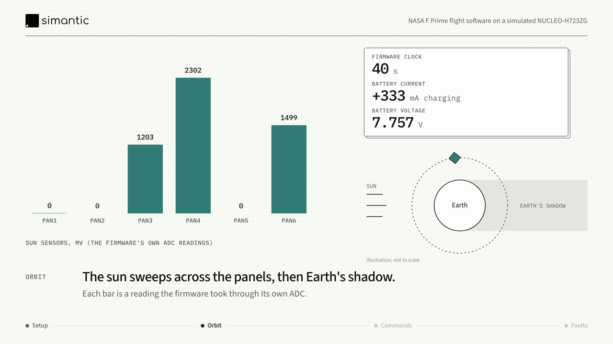
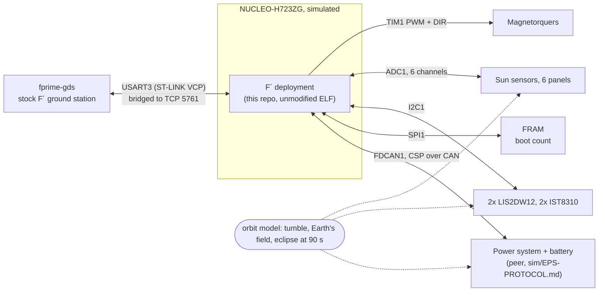

# F´ in a simulated orbit: run it with one command

This fork adds a demo to the F´ Zephyr reference: the deployment, built for the
upstream-tested **NUCLEO-H723ZG**, runs unmodified on a simulated board inside an
orbit and power environment, with the stock F´ ground station attached. No board,
no satellite.

**Media demo (34 s)**, the short cut for sharing:

[](video/media-demo.mp4)

**Technical demo (60 s)**, from reset to orbit: what is in the firmware file, how it loads, the clock
registers it writes at boot, and its 10 Hz and 1 Hz loops as the simulator timed them:
[video/technical-demo.mp4](video/technical-demo.mp4).

```sh
./demo            # nominal: orbit, eclipse, commands, detumble
./demo faults     # the power system damages three replies; the firmware retries each one
# F´ GDS web UI while it runs: http://127.0.0.1:5800
```

Needs `sim` (Simantic's simulator, proprietary; `curl -fsSL https://simantic.com/install | sh`)
and Python 3.10-3.13 for `fprime-gds`. The ELF and dictionary are prebuilt in `sim/`, so
no Zephyr SDK is needed; `sim/build.sh` rebuilds them.



What `./demo` shows (its walkthrough prints each step):

| Step | What happens |
|---|---|
| Orbit | The sun sweeps across the panels; the firmware reads it through its own ADC. The battery charges at about +330 mA. |
| Eclipse | At 90 s every sun sensor reads 0 and the battery goes to -195 mA. Nothing tells the firmware; it sees it through its sensors and the power system's replies. |
| Commands | `EPS_PING` over CSP/CAN, `MTQ_SET Y 40` (PWM duty), `FRAM_WRITE` then `FRAM_READ` 0xCAFEF00D over SPI, each through the F´ dispatcher. |
| Detumble | The B-dot loop drives the coils from the magnetometer. The orbit model spins the satellite kinematically, so the rate does not drop (no attitude dynamics). |
| Faults (`./demo faults`) | Housekeeping requests 30, 40 and 50 lose a CAN frame, arrive corrupted, and arrive late; the firmware reports `HkRetry` and recovers on attempt 2 each time. |

Pins, files and what is modelled: [`sim/README.md`](sim/README.md). The power-system
protocol is made up for this demo: [`sim/EPS-PROTOCOL.md`](sim/EPS-PROTOCOL.md). The
video is generated from two recorded runs (`video/`; every number on screen comes from
`video/runs/`).

Branch `simantic-sim-demo`, merged up to fprime-community/fprime-zephyr-reference `devel` at `4af31f4`.

---

# fprime-zephyr-reference project
This project is an implementation of F` on Zephyr RTOS. 

<!-- Not sure if this will be true in the future -->
<!-- > [!Note]
> This deployment by default builds for the Teensy 4.1 development board and has been verified on macOS and on Windows 11 using WSL (Ubuntu 22.04 LTS). 
>  -->

## System Requirements
- F Prime System Requirements listed [here](https://fprime.jpl.nasa.gov/latest/docs/getting-started/installing-fprime/#system-requirements)
- Zephyr dependencies listed [here](https://docs.zephyrproject.org/latest/develop/getting_started/index.html#install-dependencies)
- Minimum required **CMake version: 3.27.0**

## Prerequisites
1. Follow the [Hello World Tutorial](https://fprime.jpl.nasa.gov/latest/tutorials-hello-world/docs/hello-world/)
2. Follow the [Zephyr Getting Started Guide](https://docs.zephyrproject.org/latest/develop/getting_started/index.html). Ensure that the Zephyr's dependencies and SDK have been installed
3. If you are using WSL, make sure to refer to the [WSL Notes][wsl-notes] docs

## Table of Contents
1. [Initial Project Setup][initial-setup]
2. [Building, Flashing, and Running the Deployment][build-flash-run]

## Additional Resources
- [Using a Custom Board Configuration][custom-board]
- [Tested Board List][board-list]
- [Troubleshooting][troubleshooting]
- [WSL Notes][wsl-notes]

<!-- Links -->
[initial-setup]: ./docs/main-content/initial-setup.md
[board-dependencies]: ./docs/main-content/board-dependencies.md
[build-flash-run]: ./docs/main-content/build-flash-run.md
[custom-board]: ./docs/additional-resources/specifying-board-configuration.md
[board-list]: ./docs/additional-resources/board-list.md
[troubleshooting]: ./docs/additional-resources/troubleshooting.md
[wsl-notes]: ./docs/additional-resources/wsl-notes.md